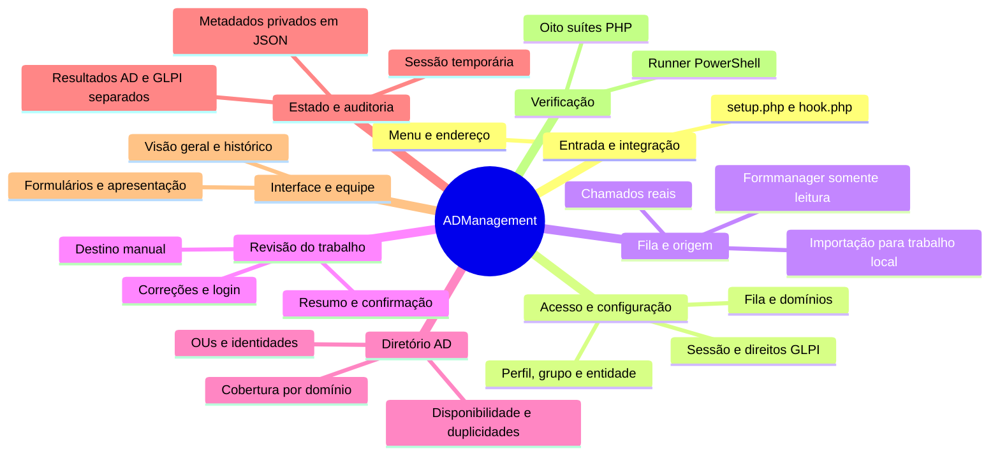
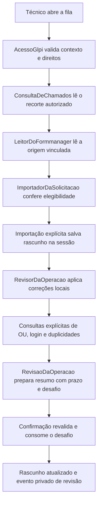

# Estrutura e arquitetura do ADManagement

Base: código local da versão 0.6.0, consultado em 23/10/2026. Esta documentação descreve o estado implementado.

Abra o [mapa mental interativo](MAPA_MENTAL.html) no navegador. Cada ramo apresenta seus arquivos; selecionar um arquivo mostra responsabilidade, pontos de entrada públicos e referências a classes do próprio plugin.


## Visão da arquitetura

O ADManagement é um plugin PHP com páginas renderizadas no servidor. O GLPI fornece a sessão, os direitos nativos, a conexão de banco e os componentes de interface. As entradas em `front/` coordenam requisições; as classes de `src/` concentram políticas, consultas, persistência e apresentação.

A organização é por responsabilidade. Os scripts HTTP possuem parte da coordenação, e classes como `RevisaoDaOperacao` e `DestinoDaOperacao` também possuem métodos de apresentação. Ao alterar o fluxo, confira a entrada HTTP e as classes que ela chama.



## Pastas e pontos de entrada

```text
admanagement/
├── setup.php             Identidade, requisitos e hooks
├── hook.php              Instalação e desinstalação
├── composer.json         Requisitos, namespace e scripts de teste
├── config/acesso.php     Valores locais de autorização
├── front/                Entradas HTTP e montagem das páginas
├── src/                  Classes próprias do plugin
├── tests/                Suítes, dublês e dados de contrato
├── documentacao/         Mapa mental e este guia
└── README.md             Apresentação e orientações iniciais
```

| Entrada HTTP | Trabalho principal |
| --- | --- |
| [front/index.php](../front/index.php) | Fila pessoal e impedimentos de importação. |
| [front/revisao.php](../front/revisao.php) | Importar, corrigir, consultar o diretório, preparar e confirmar o resumo; descartar rascunho. |
| [front/config.php](../front/config.php) | Configuração administrativa de acesso, grupos/categorias e LDAP de leitura. |
| [front/overview.php](../front/overview.php) | Visão geral dos atendimentos da equipe. |
| [front/historico.php](../front/historico.php) | Solucionados e fechados da equipe. |
| [front/pending.php](../front/pending.php) | Pendências locais e orientação sobre estados duráveis. |
| [front/audit.php](../front/audit.php) | Eventos privados visíveis ao ator e à entidade atuais, respeitando leitura do ticket. |

## Como uma revisão percorre o código



1. **Autorizar:** a identidade vem da sessão GLPI. O acesso combina direitos nativos com perfil, grupo e entidade configurados. URLs diretas também passam pela verificação.
2. **Ler a origem:** a fila usa categorias exatas e atribuição individual ou por grupo. Ao abrir um ID, o código revalida categoria, entidade e direito de leitura; esse caminho de correção não exige atribuição pessoal.
3. **Importar:** o formulário precisa ter vínculo único de rede com o chamado, status 3, solicitação de rede e entidade correspondente. Os serviços aceitos são `CADASTRO` e `RENOVAR USUÁRIO`. O importador monta dados e uma assinatura; a persistência na sessão ocorre na ação explícita.
4. **Corrigir:** campos de trabalho são ajustados no rascunho. A revisão esperada evita sobrescrever uma aba mais recente. Reimportar exige confirmação porque substitui correções locais.
5. **Consultar o AD:** os comandos explícitos chamam o coordenador e o adaptador LDAP. O domínio e a OU são escolhidos manualmente; a OU deve existir no catálogo real vigente. Candidatos de login, disponibilidade e duplicidades são resultados separados.
6. **Revisar o resumo:** conteúdo, origem, contexto, configuração e evidências observadas participam da vigência. O resumo dura 600 segundos; o catálogo de OUs dura 300 segundos. Evidências também têm prazo e precisam continuar válidas.
7. **Confirmar o trabalho:** o desafio é validado e consumido. A confirmação é salva no rascunho e gera evento de auditoria. O código atual não executa criação/renovação no AD nem finaliza o chamado.

O controlador relê a origem inclusive ao abrir a página. Mudanças observadas ou revogação de acesso invalidam o resumo. Não há monitoramento contínuo da origem entre requisições.

## Onde os dados ficam

| Dados | Local | Responsável | Efeito |
| --- | --- | --- | --- |
| Chamados, atribuições e equipe | Banco GLPI, via `$DB` e modelos nativos | `ConsultaDeChamados`, `AcompanhamentoDaEquipe` | Leitura nas consultas do plugin. |
| Formulário de origem | `glpi_plugin_formmanager_forms_atual` | `LeitorDoFormmanager` | Leitura, sem carregar código ou alterar registros do outro plugin. |
| Configurações próprias | `Config` do GLPI, contexto `admanagement`, mais os padrões locais | `ConfiguracaoOperacional`, `ConfiguracaoDaFila` e agregadores | Gravação administrativa das escolhas do plugin. |
| Trabalho e evidências temporárias | `$_SESSION`, separados por técnico, entidade e chamado | `RepositorioDeRascunhos` | Estado temporário de revisão. |
| Auditoria e contratos de operação | `GLPI_VAR_DIR/_plugins/admanagement/estado.json` | `RepositorioDeOperacoes` | Metadados duráveis privados, com lock e substituição atômica. |
| Credenciais de bind LDAP | Ambiente do servidor | `LeitorLdap`, a partir dos nomes configurados | Uso na conexão; a configuração guarda os nomes das variáveis. |
| OUs, logins e identidades AD | Diretórios LDAP configurados | `LeitorLdap`, `VerificadorDoDiretorio` | Consultas de leitura por comando explícito. |

`RepositorioDeRascunhos::comAuditoria()` restaura o rascunho se a ação auditada falhar. Isso não constitui uma transação conjunta entre banco GLPI, sessão e diretório AD. Corrupção ou falha de persistência durável bloqueia a continuidade correspondente.

CPF e respostas LDAP completas não integram o resumo ou a auditoria mínima. O coordenador lê identificadores necessários durante a verificação de duplicidades e descarta os dados transitórios ao terminar a chamada.

## Comportamento atual e contratos preparados

| Situação | Implementação |
| --- | --- |
| Fila, importação, correção e resumo | Disponíveis no fluxo local de revisão. |
| Consulta AD | Adaptador e verificações de leitura implementados; dependem da configuração e infraestrutura reais. |
| Auditoria de revisão | Usada pelas ações atuais, com metadados mínimos. |
| Reserva e tentativa de operação | Contratos duráveis em `RepositorioDeOperacoes`, exercitados nos testes; não são um executor AD ligado às rotas. |
| Resultado AD e finalização GLPI | Estados independentes e política de recuperação implementados; a presença desses métodos não significa operação externa executada. |
| Criação/renovação no AD e fechamento do chamado | Bloqueados nesta versão; `PoliticaDeResultados::exigirExecucaoReal()` sempre recusa a execução. |

Resultados incertos exigem reconciliação sem repetição automática do AD. Sucesso AD comprovado só permite prosseguir para a finalização do chamado originalmente fixado. Efeitos de atributos, grupos, scripts, pastas, validade, identidade da renovação e adaptadores de escrita continuam dependentes de definição e homologação.

## Catálogo por responsabilidade

Os grupos abaixo são uma organização explicativa deste guia. O código permanece nas pastas originais. As referências entre classes indicam usos presentes no fonte, não um rastreamento completo das chamadas em execução.

### Entrada e integração

setup.php declara a versão, os requisitos e os hooks do menu. hook.php participa da instalação e desinstalação. As páginas de front/ carregam o bootstrap do GLPI antes de usar sua sessão, conexão e classes.

| Arquivo | Responsabilidade |
| --- | --- |
| [setup.php](../setup.php) | Registra a identidade, a faixa de versões alvo e os hooks de menu/configuração do plugin. |
| [hook.php](../hook.php) | Implementa os pontos de instalação e desinstalação consultados pelo GLPI. |
| [composer.json](../composer.json) | Declara requisitos, associação PSR-4 do namespace e atalhos para as oito suítes. |
| [src/MenuDaFerramenta.php](../src/MenuDaFerramenta.php) | Define os links do plugin que o usuário atual pode visualizar no menu GLPI. |
| [src/EnderecoDaFerramenta.php](../src/EnderecoDaFerramenta.php) | Resolve a URL nativa sem depender da localização física plugins/marketplace. |

A instalação atual não cria tabelas nem concede direitos. O namespace declarado no Composer é GlpiPlugin\Admanagement, associado à pasta src/.

### Acesso e configuração

AcessoGlpi obtém o contexto da sessão nativa; ControleDeAcesso avalia perfil, grupo e entidade. As classes Configuracao* reúnem ou persistem as escolhas administrativas. EntradaDaFerramenta valida IDs e textos recebidos.

| Arquivo | Responsabilidade |
| --- | --- |
| [src/AcessoGlpi.php](../src/AcessoGlpi.php) | Confere as permissões usando a sessão que o próprio GLPI mantém. |
| [src/ControleDeAcesso.php](../src/ControleDeAcesso.php) | Aplica as permissões próprias, com exceção local explícita para testes autorizados. |
| [src/ConfiguracaoDeAcesso.php](../src/ConfiguracaoDeAcesso.php) | Reúne as permissões do arquivo local e os grupos salvos na configuração da fila. |
| [src/ConfiguracaoOperacional.php](../src/ConfiguracaoOperacional.php) | Guarda escolhas administrativas próprias sem criar tabelas nem conceder direitos. |
| [src/ConfiguracaoDaFila.php](../src/ConfiguracaoDaFila.php) | Centraliza a leitura, a validação e a gravação dos grupos e categorias usados na fila. |
| [src/ConfiguracaoDoDiretorio.php](../src/ConfiguracaoDoDiretorio.php) | Configura somente leitura LDAP; senhas continuam no ambiente do servidor. |
| [src/EntradaDaFerramenta.php](../src/EntradaDaFerramenta.php) | Valida os valores recebidos antes de usá-los nas consultas e nos rascunhos. |
| [config/acesso.php](../config/acesso.php) | Fornece os valores locais de acesso e a exceção de laboratório, desativada por padrão. |
| [front/config.php](../front/config.php) | Protege e processa as telas administrativas de acesso, fila e conexões LDAP de leitura. |

Listas operacionais vazias negam acesso. A configuração exige o direito administrativo nativo de configuração. Senhas LDAP são obtidas do ambiente, não armazenadas pela tela.

### Fila e origem

front/index.php consulta a fila e apresenta seus impedimentos. ConsultaDeChamados aplica o escopo do GLPI. LeitorDoFormmanager verifica a estrutura da origem e seus vínculos. ImportadorDaSolicitacao valida a elegibilidade e monta um rascunho em memória.

| Arquivo | Responsabilidade |
| --- | --- |
| [front/index.php](../front/index.php) | Carrega o GLPI, autoriza o técnico, consulta a fila e mostra impedimentos da origem. |
| [src/ConsultaDeChamados.php](../src/ConsultaDeChamados.php) | Consulta a fila respeitando categoria, entidade, atribuição e permissão de leitura. |
| [src/LeitorDoFormmanager.php](../src/LeitorDoFormmanager.php) | Lê os formulários de origem sem executar ações ou gravar dados no formmanager. |
| [src/ImportadorDaSolicitacao.php](../src/ImportadorDaSolicitacao.php) | Transforma um formulário aprovado e vinculado ao chamado em dados de trabalho locais. |

A listagem verifica elegibilidade sem salvar rascunhos. A importação exige um vínculo único de rede, formulário aprovado e a mesma entidade; não altera chamado nem formulário.

### Revisão do trabalho

front/revisao.php relê autorização, chamado e origem, trata as ações e salva o rascunho com auditoria. CoordenadorDaRevisao encaminha os comandos de consulta e resumo. RevisorDaOperacao aplica correções; as políticas de login, destino e vigência validam o conteúdo.

| Arquivo | Responsabilidade |
| --- | --- |
| [front/revisao.php](../front/revisao.php) | Controla importação, correção, consultas, resumo, confirmação e descarte do trabalho local. |
| [src/CoordenadorDaRevisao.php](../src/CoordenadorDaRevisao.php) | Coordena ações locais depois da releitura obrigatória de ticket, origem e autorização. |
| [src/RevisorDaOperacao.php](../src/RevisorDaOperacao.php) | Aplica correções no rascunho local e informa o que ainda precisa de revisão. |
| [src/RevisaoDaOperacao.php](../src/RevisaoDaOperacao.php) | Associa o resumo ao conteúdo, à origem e à autorização atuais, sem executar efeitos no AD. |
| [src/PoliticaDeLogin.php](../src/PoliticaDeLogin.php) | Compõe sugestões textuais de login; a consulta ao AD ainda não faz parte desta classe. |
| [src/DestinoDaOperacao.php](../src/DestinoDaOperacao.php) | Valida a escolha manual contra o catálogo real e sua configuração vigente. |

Confirmação significa revisão de trabalho. O resumo tem prazo e desafio consumível; mudanças observadas na origem, no contexto ou na configuração podem invalidá-lo.

### Diretório AD

LeitorLdap concentra a conexão e as pesquisas LDAP. VerificadorDoDiretorio combina os resultados por domínio e distingue cobertura completa, ocorrência e falha de consulta. NomeDistinto trata caminhos LDAP e pertencimento à Base DN.

| Arquivo | Responsabilidade |
| --- | --- |
| [src/LeitorLdap.php](../src/LeitorLdap.php) | Único adaptador LDAP do produto: possui exclusivamente métodos de leitura. |
| [src/VerificadorDoDiretorio.php](../src/VerificadorDoDiretorio.php) | Separa candidatos, disponibilidade e duplicidades, com cobertura explícita de todos os domínios. |
| [src/NomeDistinto.php](../src/NomeDistinto.php) | Manipula caminhos LDAP preservando vírgulas escapadas e a identidade do ramo. |

Consultas acontecem por comando explícito. Login sugerido não prova disponibilidade; falha de consulta não prova inexistência. O adaptador possui métodos de leitura.

### Estado e auditoria

RepositorioDeRascunhos usa a sessão e controla revisões. RepositorioDeOperacoes mantém metadados privados em JSON com lock e substituição atômica. PoliticaDeResultados distingue o resultado do AD do resultado da finalização no GLPI.

| Arquivo | Responsabilidade |
| --- | --- |
| [src/RepositorioDeRascunhos.php](../src/RepositorioDeRascunhos.php) | Guarda o trabalho na sessão, separado por técnico, entidade e chamado. |
| [src/RepositorioDeOperacoes.php](../src/RepositorioDeOperacoes.php) | Preserva somente metadados privados, com lock exclusivo e substituição atômica. |
| [src/PoliticaDeResultados.php](../src/PoliticaDeResultados.php) | Mantém AD e fechamento como resultados independentes e fixa o alvo de cada tentativa. |
| [front/pending.php](../front/pending.php) | Exibe rascunhos com pendências e as orientações derivadas dos estados duráveis visíveis. |
| [front/audit.php](../front/audit.php) | Lista até cem eventos visíveis, filtrados pelo ator, entidade e direito de leitura do chamado. |

Os contratos de reserva, tentativa e resultado existem para um executor futuro. As rotas atuais não os transformam em escrita AD ou fechamento de chamado; a auditoria de revisão já é usada.

### Interface e equipe

InterfaceDaFerramenta fornece a estrutura visual comum e o CSS. FormularioDaSolicitacao e Apresentacao* renderizam dados e controles. PaginaDaEquipe usa AcompanhamentoDaEquipe para apresentar visão geral e histórico com os direitos nativos por chamado.

| Arquivo | Responsabilidade |
| --- | --- |
| [src/InterfaceDaFerramenta.php](../src/InterfaceDaFerramenta.php) | Organiza a apresentação PHP sem consultar dados ou executar ações do técnico. |
| [src/FormularioDaSolicitacao.php](../src/FormularioDaSolicitacao.php) | Mostra a fila e os formulários em PHP, escapando os textos vindos dos dados. |
| [src/ApresentacaoDaConfiguracao.php](../src/ApresentacaoDaConfiguracao.php) | Apresenta parâmetros administrativos de acesso e leitura, sem oferecer escrita no AD. |
| [src/ApresentacaoDeConsultas.php](../src/ApresentacaoDeConsultas.php) | Explica disponibilidade e cobertura sem confundir ausência de resposta com ausência de conta. |
| [src/PaginaDaEquipe.php](../src/PaginaDaEquipe.php) | Apresenta atendimentos reais da equipe e mantém o histórico distinto da auditoria. |
| [src/AcompanhamentoDaEquipe.php](../src/AcompanhamentoDaEquipe.php) | Consulta atendimento coletivo sem confundir histórico de chamados com efeitos no AD. |
| [front/overview.php](../front/overview.php) | Abre a visão geral da equipe por meio de PaginaDaEquipe::mostrar(false). |
| [front/historico.php](../front/historico.php) | Abre o histórico de solucionados e fechados com PaginaDaEquipe::mostrar(true). |

O HTML é gerado pelo PHP. Histórico da equipe, auditoria do plugin e resultado AD são informações diferentes. Algumas classes de revisão também possuem métodos mostrar().

### Verificação

As oito suítes são scripts PHP independentes. O runner PowerShell executa cada uma em um processo e interrompe na primeira falha. O Composer declara atalhos equivalentes. Dublês e dados de contrato ficam em tests/.

| Arquivo | Responsabilidade |
| --- | --- |
| [tests/acesso.php](../tests/acesso.php) | Verifica a política de perfil, grupo e entidade, inclusive entradas inválidas e a exceção local. |
| [tests/carregamento.php](../tests/carregamento.php) | Verifica os contratos de descoberta, instalação e carregamento do plugin. |
| [tests/refatoracao.php](../tests/refatoracao.php) | Exercita os contratos de leitura, validação e apresentação cobertos pela refatoração. |
| [tests/fluxo.php](../tests/fluxo.php) | Verifica o encadeamento de importação, edição e armazenamento do trabalho local. |
| [tests/regras_http.php](../tests/regras_http.php) | Exercita a entrada HTTP de revisão com dublês do GLPI e verifica as respostas e transições. |
| [tests/regras_vigentes.php](../tests/regras_vigentes.php) | Verifica regras da revisão, destino, login, diretório e resultados com dados de contrato. |
| [tests/concorrencia.php](../tests/concorrencia.php) | Usa processos concorrentes para verificar a exclusividade da reserva e a integridade do registro. |
| [tests/documentacao.php](../tests/documentacao.php) | Usa tokens PHP para conferir comentários em classes, funções, condições, ramos e laços. |
| [tests/run.ps1](../tests/run.ps1) | Executa as oito suítes PHP em processos separados e propaga a primeira falha. |

Essas verificações locais ajudam a detectar regressões. A homologação operacional nas instalações GLPI e no PHP web continua sendo uma etapa própria.

## Roteiro para estudar ou alterar

1. Leia `setup.php`, `MenuDaFerramenta` e `front/index.php` para localizar carregamento, menu e fila.
2. Siga `front/revisao.php` até `CoordenadorDaRevisao`, `RevisorDaOperacao` e `RevisaoDaOperacao` para entender o fluxo central.
3. Confira `ImportadorDaSolicitacao` e `LeitorDoFormmanager` antes de mudar dados vindos da origem.
4. Confira `ConfiguracaoDoDiretorio`, `LeitorLdap` e `VerificadorDoDiretorio` antes de mudar consultas AD ou conclusões de disponibilidade.
5. Confira os dois repositórios e `PoliticaDeResultados` antes de mudar estado, auditoria ou repetição.
6. Use o mapa para encontrar os pontos públicos e as referências da classe que será alterada; então execute as suítes relacionadas.

## Verificação do projeto

Na raiz do plugin, execute `./tests/run.ps1`. Se o PHP não estiver no PATH, use `./tests/run.ps1 -ExecutavelPhp 'caminho/para/php.exe'`. Cada suíte também pode ser chamada com `php tests/<nome>.php` ou com o script Composer equivalente.

Os 47 arquivos PHP, as 29 classes de `src/` e as oito suítes existentes estão representados no mapa. A contagem se refere a esta versão do código; atualize o mapa e o guia quando adicionar, remover ou mudar responsabilidades.

As classes próprias usam português brasileiro. Contratos GLPI/PHP, namespace, rotas e chaves externas mantêm seus nomes. Preserve os comentários de classes, funções, condições e laços e o espaçamento adotado; a suíte `documentacao` verifica a cobertura estrutural dos comentários.
